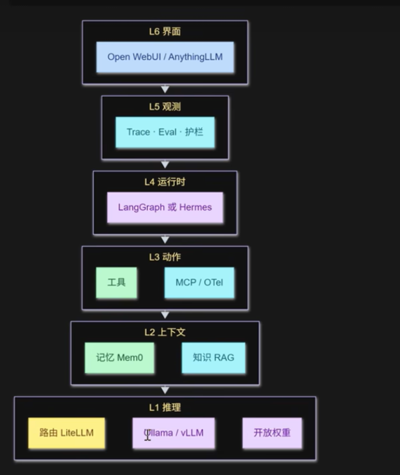

# mini-pi

从 0 手写的极简 coding agent harness —— 对照 pi（生产级 agent 框架）源码逐层学习
agent 的工程实现方式。

不是"调 API 的聊天脚本"：agent 循环、工具调用、流式输出、上下文压缩、工具路由、
可观测性（trace）……每一层能力都亲手实现，每个关键设计决策都对照生产实现
（pi / Claude Code / Codex / OTel semconv）记录取舍与出处，并做真机端到端验证。

- 约 2100 行 TypeScript（`src/`），内核零 UI / 零框架依赖（唯一运行时依赖是
  `@sinclair/typebox`，用于工具参数 schema）
- 7 个确定性测试文件（`npm test` 全绿）+ `tsc --noEmit` 类型检查
- 每层实现日志见 [DEVLOG.md](./DEVLOG.md)；故障复盘见 [ERRORS.md](./ERRORS.md)

## 能力总览

按实现顺序排列（对应 [DEVLOG.md](./DEVLOG.md) 的 F1–F12）：

| # | 能力 | 要点 |
|---|------|------|
| F1 | 一层 Agent Loop | 双层循环（外层等用户 / 内层跑工具直到模型不再要工具）；哑内核 + 事件流，UI 逻辑全在会话层 |
| F2 | 多模型切换 | 声明式注册 `deepseek / glm / kimi`，`provider/modelId` 二级寻址，`/model` 运行时切换（auth 预检） |
| F3 | 工具调用 | `read_file` / `write_file` / `list_dir` / `run_command`；工具错误回填为结果，让模型自愈 |
| F4 | 参数校验 | typebox 先 Convert 强转、再 Check 严校；错误文本是写给模型的提示词，坏参数进不了文件系统 |
| F5 | 截断保护 | `finish_reason=length` 时本轮所有 tool_calls 一律不执行、逐个回填错误（协议配对不破） |
| F6 | Steering | 执行期间的用户输入缓存在队列，在回合边界注入（one-at-a-time FIFO） |
| F7 | Abort + 迭代上限 | `/stop` → AbortSignal 贯穿流式读取与子进程；`MAX_TURNS` 超限时柔性收尾 |
| F8 | 流式输出 | 手工 SSE 解析逐 delta 渲染；连接阶段失败指数退避重试（流开始后不重试） |
| F9 | 记忆 | JSONL 会话底账 + `--resume` 重放；超阈值自动压缩（结构化摘要 + 保留近期，底账不删） |
| F10 | 质量 | 以 DEVLOG 行为为基准的代码审查（修复 2 个高危缺陷）+ 项目内回归测试套件 |
| F11 | 工具路由 | `ToolRegistry` + `DENY_TOOLS`（暴露过滤）/ `ENFORCE_RULES`（参数级执行门控）双层权限 + `search_tools` 软路由 |
| F12 | 可观测性 | 旁听事件流重建 span → JSONL 落盘 → `/trace` 树展示；默认脱敏，内容门控 opt-in |

## 快速开始

**环境要求**：Node.js >= 20

```bash
npm install
cp .env.example .env    # 至少填入一个 provider 的 API Key
npm start
```

运行方式：

```bash
npm start                    # 交互模式：自动选第一个配了 Key 的模型
npm start glm/glm-4.6        # 指定初始模型（provider/modelId 二级寻址）
npm start -- --resume        # 恢复上次会话（-- 之后是脚本参数）
```

内置模型（均走 OpenAI 兼容端点）：

| provider/modelId | Key 环境变量 | 上下文窗口 |
|---|---|---|
| `deepseek/deepseek-chat` | `DEEPSEEK_API_KEY` | 128k |
| `deepseek/deepseek-reasoner` | `DEEPSEEK_API_KEY` | 128k |
| `glm/glm-4.6` | `GLM_API_KEY` | 200k |
| `kimi/kimi-k2` | `MOONSHOT_API_KEY` | 256k |

## 使用

### 斜杠命令

| 命令 | 说明 |
|---|---|
| `/model` | 列出全部模型与当前模型 |
| `/model <provider/modelId>` | 切换模型（先做 auth 预检，下一轮生效） |
| `/compact` | 手动排程上下文压缩（下一次 LLM 请求前执行） |
| `/stop` | 立即中止当前任务（流式输出与工具执行同时中断） |
| `/trace` | 查看最近任务的 trace 树（带 ttft、耗时、事件标注） |
| `exit` | 退出（`--resume` 可恢复会话） |

执行期间输入普通文本 = steering（缓存在队列、回合边界注入）；输入 `exit` = 当前回合结束后退出。

### 环境变量

全部旋钮（默认值见括号）：

| 变量 | 说明 |
|---|---|
| `DEEPSEEK_API_KEY` / `GLM_API_KEY` / `MOONSHOT_API_KEY` | 每个 provider 一个 Key，共存互不影响 |
| `LLM_BASE_URL` | 任何 OpenAI 兼容端点（默认 provider 自带地址，路径自动补全） |
| `LLM_TIMEOUT_MS` | 请求超时，含流式读取全程（120000） |
| `LLM_MAX_RETRIES` | 连接阶段失败重试次数（3） |
| `LLM_MAX_TOKENS` | 输出 token 上限（provider 默认） |
| `MAX_TURNS` | 单任务最大 LLM 回合数，防失控（30） |
| `COMPACT_RESERVE_TOKENS` | 压缩触发线预留空间（16384） |
| `COMPACT_KEEP_RECENT_TOKENS` | 压缩时必保留的近期 token（20000） |
| `DENY_TOOLS` | 暴露过滤：命中的工具从请求中移除，模型看不见（逗号分隔，`shell:*` 形式） |
| `DEFER_TOOLS` | 软路由：命中的工具延迟加载，模型经 `search_tools` 按需召回 |
| `ENFORCE_RULES` | 执行门控：参数级 `argsRegex` 规则（如禁 `rm`） |
| `SYSTEM_PROMPT` | 覆盖默认 system prompt |
| `MINI_PI_TRACE_CONTENT` | 置 1 时 trace 记录正文（截断 200 字符）；默认只记长度/计数 |

## 架构

### 分层视角

项目沿通用 agent 分层视角（L1 推理 → L6 界面）自内向外推进：先打牢推理与上下文
底座，再向上补动作（工具/路由）与观测（trace），界面保持最简 CLI。当前实现覆盖
L1–L3 主体与 L5 的 Trace 底座，完整形态见下图：



### 目录结构

```
src/
├── main.ts                  # 会话层：readline UI、斜杠命令、流式渲染（循环不感知 UI）
├── ai/                      # LLM 层
│   ├── index.ts             #   StreamFn 契约、流式实现、连接重试、消息 ↔ wire 转换
│   ├── sse.ts               #   手工 SSE 解析（TextDecoder 跨 chunk 多字节）
│   └── models.ts            #   模型注册表 + 二级寻址 + Key 解析
├── agent/                   # Agent 内核（哑内核：不打印、不读 env、只发事件）
│   ├── agent-loop.ts        #   双层循环、事件流、steering / abort / 迭代上限
│   ├── tools.ts             #   4 个内置工具（带 domain/tags 元数据）
│   ├── validation.ts        #   参数校验（Convert → Check → 错误格式化）
│   ├── compaction.ts        #   自动压缩（估算 / 阈值 / 安全切点 / 摘要 prompt）
│   ├── tool-registry.ts     #   工具路由：registry + 暴露过滤 + 执行门控
│   └── soft-routing.ts      #   search_tools 元工具 + 活跃集差分声明
├── session/                 # 持久化：append-only JSONL 底账 + 重放投影
└── telemetry/               # L5 观测：事件流重建 span / JSONL store / 树视图
tests/                       # 确定性回归测试（npm test）
docs/                        # 调研存档（对照 pi / Claude Code / Codex / OTel）
```

### 核心设计原则

贯穿全部实现的五条原则（每条在 DEVLOG 中都有对照 pi 源码的出处）：

1. **哑内核 + 事件流**：循环只发 `AgentEvent`、不做任何打印；UI 与 trace 都是事件的旁路消费者
2. **systemPrompt 与对话历史分离**：仅在 LLM 调用边界拼接，历史保持 provider 中立
3. **调用边界转换**：内部统一消息格式，出网时才转成 wire 格式——换协议只改一处
4. **投影变、底账不变**：压缩与恢复只追加条目（compaction / model_change），历史底账永不改写
5. **观测旁路**：trace 收集器整体吞错、落盘失败静默——观测失败绝不影响主流程

## 测试与质量

```bash
npm run typecheck   # tsc --noEmit
npm test            # 7 个测试文件：控制流 / 审查回归 / 路由 / 会话与压缩 / 软路由 / 流式 / trace
```

## 文档

| 文档 | 内容 |
|---|---|
| [DEVLOG.md](./DEVLOG.md) | 每层实现日志：做了什么、关键设计决策（对照 pi 源码位置）、验证结果、排障与踩坑 |
| [ERRORS.md](./ERRORS.md) | 6 个典型故障复盘（404 / EOF / readline 丢行 / 无校验参数 / 模型方言 / TTY 回显） |
| [docs/memory-research.md](./docs/memory-research.md) | 上下文记忆调研（对照 pi 实证） |
| [docs/tool-routing-research.md](./docs/tool-routing-research.md) | 工具路由调研（Claude Code 双层权限 / Tool Search / pi loader 模式） |
| [docs/observability-research.md](./docs/observability-research.md) | 可观测性调研（pi callback / Codex rollout / OTel semconv） |

## License

[MIT](./LICENSE)
